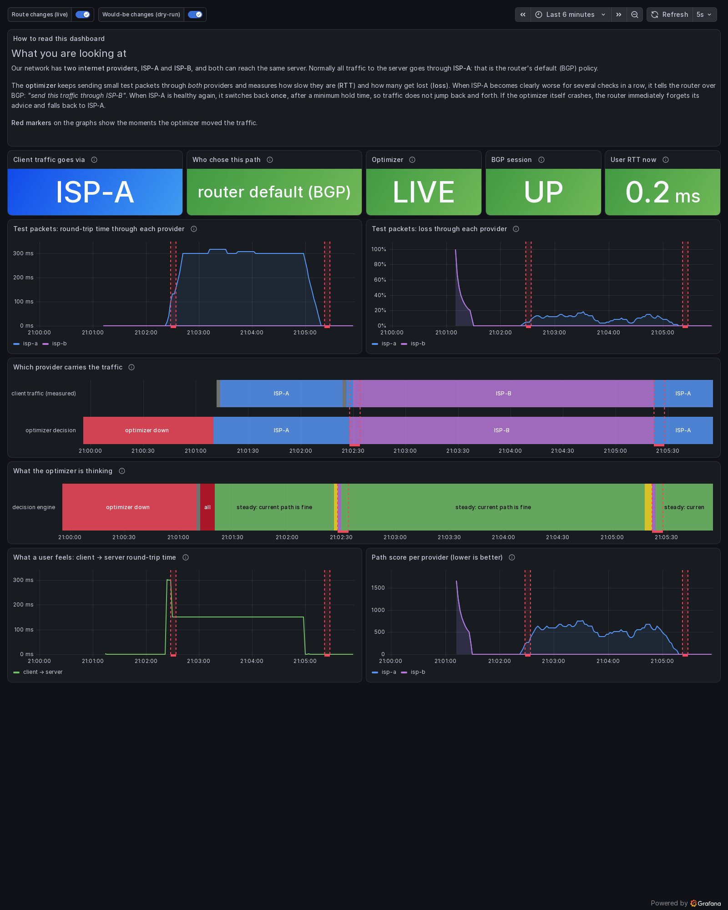
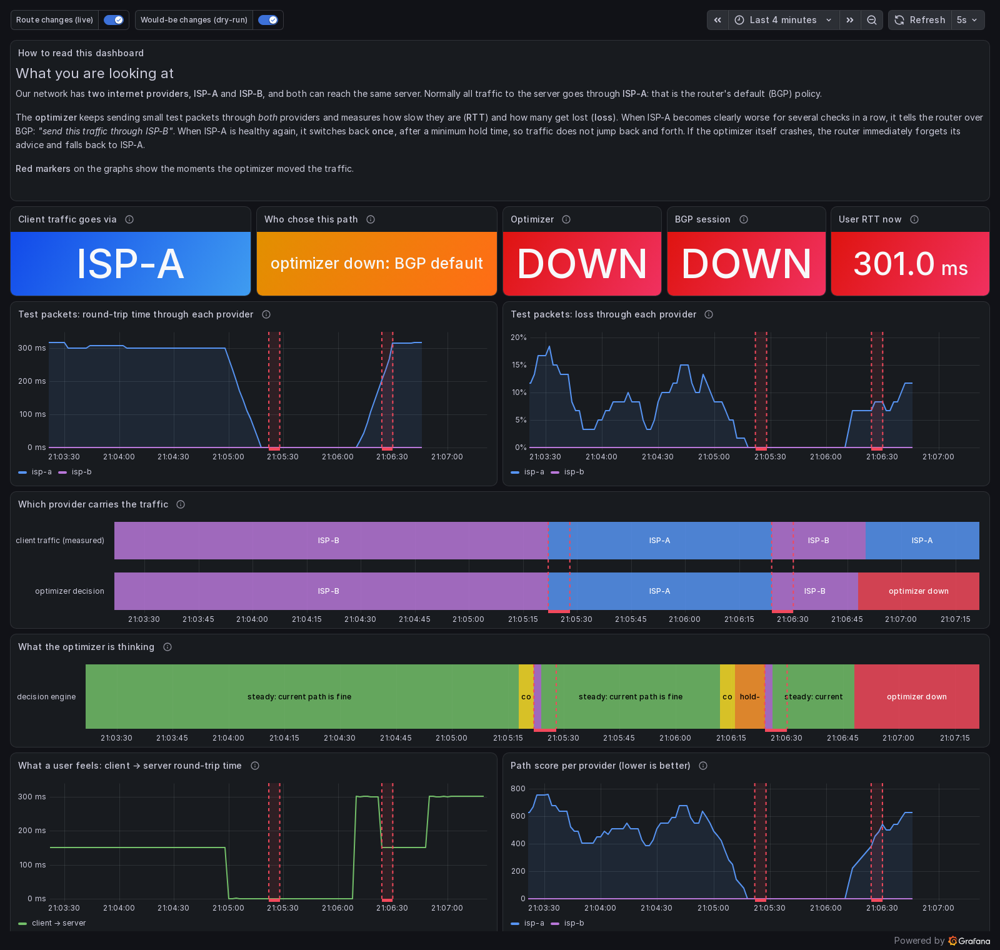

# BGP Pathfinder: outbound BGP path optimizer prototype

A prototype of BGP Pathfinder System. It keeps measuring the path quality to important prefixes through each upstream provider. When the current path degrades, it injects a route via the better provider into the border router over iBGP. When the path recovers, it removes the injection, without flapping.

Everything runs locally in a [containerlab](https://containerlab.dev) lab: FRR 10.5 as the routers, ExaBGP 4.2 plus Python 3.12 as the optimizer.

The goal is to prove the idea: **break a link → the system moves traffic away by itself → fix the link → the system moves traffic back exactly once, with no flapping**. Plus a fail-safe: if the optimizer dies, the network falls back to plain BGP on its own.

```
client ── EDGE (AS65000) ──┬── ISP-A (AS65001) ──┐
              │            └── ISP-B (AS65002) ──┴── INET (AS65100) ── target
          optimizer (ExaBGP, iBGP AS65000)
```

More detail: [docs/ARCHITECTURE.md](docs/ARCHITECTURE.md) (components and data flow), [docs/DECISIONS.md](docs/DECISIONS.md) (design decisions and deviations from the spec), [docs/REPORT.md](docs/REPORT.md) (final report).

## See it on a dashboard

After `make lab-up`, open **http://localhost:3000**.

| Panel | What it tells you |
|---|---|
| **Client traffic goes via** | the provider real traffic uses right now, measured by traceroute from the client |
| **Who chose this path** | router default (plain BGP), optimizer override, or "optimizer down" |
| **Optimizer / BGP session** | LIVE / DRY-RUN / DOWN, and whether its BGP session to the router is up |
| **User RTT now** | what a user of the network feels at this moment |
| Test packets: RTT and loss | the optimizer's measurements through ISP-A and ISP-B side by side |
| Which provider carries the traffic | timeline: measured path vs. the optimizer's decision |
| What the optimizer is thinking | timeline: steady → confirming → switching → hold-down |
| Red markers on every graph | the moments the optimizer moved the traffic |

Degrade ISP-A, the optimizer moves traffic to ISP-B, ISP-A is fixed, traffic comes back once:



Fail-safe: the optimizer was killed while ISP-A was still degraded. The router fell back to its default (ISP-A) on its own:



Prometheus itself is at http://localhost:9090. To edit the dashboard in Grafana, log in as `admin` / `admin`.

## How it works

1. **Probes through a specific provider.** The optimizer owns the addresses `10.99.1.1` and `10.99.2.1`. Edge uses `ip rule` to send traffic from them strictly via ISP-A and ISP-B respectively, regardless of the BGP best path. Every 2 s the optimizer measures RTT, loss and jitter to `198.51.100.10` through each provider: 5× ICMP plus a TCP connect to :80. Metrics are computed over a sliding window of 10 rounds.
2. **Decision engine**, a set of pure functions. Score = RTT + jitter + 25 ms per 1 % of loss. It switches only if the alternative is better by ≥ 20 ms or ≥ 2 % loss for 3 rounds in a row. A 60 s hold-down and a limit of 2 changes per minute apply. If every provider is bad or there is too little data, it touches nothing.
3. **Injection.** The optimizer runs as a `process` inside ExaBGP and writes `announce route 198.51.100.0/24 next-hop 10.2.0.2 local-preference 300 community [no-export no-advertise]` to stdout. Edge prefers that path because of local-pref 300 (> 150 for ISP-A). The route never leaves edge: the communities and the outbound prefix-lists both block it. When the base path is good again, the optimizer sends `withdraw`.
4. **Fail-safe.** If the optimizer or ExaBGP dies, the iBGP session drops and edge removes the injected route within a fraction of a second.

## Requirements

- Linux with the `sch_netem` kernel module (tested on Ubuntu 24.04 under WSL2, kernel 6.18);
- Docker 27+, containerlab 0.83+ (the user must be in the `docker` and `clab_admins` groups, or run via sudo);
- python3.12+ on the host (unit tests run in `.venv`, the scripts use it to parse JSON). `jq` is not needed;
- internet access for the first image build;
- free TCP ports 3000 (Grafana) and 9090 (Prometheus) on the host.

Pinned versions: `quay.io/frrouting/frr:10.5.5`, `alpine:3.23.8`, `python:3.12.16-slim-bookworm`, `prom/prometheus:v3.15.1`, `grafana/grafana:13.2.4`, `exabgp==4.2.25`, `PyYAML==6.0.2`, `prometheus-client==0.26.0`.

## Quick start

```bash
make lab-up      # build the images and deploy the lab (~1 min); waits for BGP and Grafana
                 # then open http://localhost:3000
make test        # unit tests (pytest in .venv)
make e2e         # automated acceptance of stages 1, 2, 4, 5 (~4-5 min); exit code 0 = all good
make lab-down    # tear the lab down
```

Run `make help` for every target. The main ones: `status`, `degrade-a`/`restore-a` (defaults `DELAY=150 LOSS=5`), `degrade-b`/`restore-b`, `optimizer-start`, `optimizer-logs`, `cover`.

## A 5-minute demo

**0. Bring the lab up** (if it is not running yet) and put http://localhost:3000 next to the terminal. Every step below is visible there within a few seconds.

```bash
make lab-up
```

**1. Initial state: traffic goes via ISP-A.**

```bash
make status
```
```
==> edge: show ip bgp 198.51.100.0/24
BGP routing table entry for 198.51.100.0/24, version 10
Paths: (2 available, best #1, table default)
  Not advertised to any peer
  65001 65100
    10.1.0.2 from 10.1.0.2 (10.1.0.2)
      Origin IGP, localpref 150, valid, external, best (Local Pref)
      Last update: Sun Nov  8 19:42:55 2026
  65002 65100
    10.2.0.2 from 10.2.0.2 (10.2.0.2)
      Origin IGP, valid, external
      Last update: Sun Nov  8 19:42:55 2026
==> client -> target: traceroute
traceroute to 198.51.100.10 (198.51.100.10), 30 hops max, 60 byte packets
 1  203.0.113.1  0.052 ms
 2  10.1.0.2  0.030 ms          <- ISP-A
 3  10.3.0.2  0.063 ms
 4  198.51.100.10  0.063 ms
==> optimizer status
mode: live | bgp 10.9.0.1: up (121s ago) | heartbeat 2s ago

PREFIX             PROVIDER   RTT ms  JITTER  LOSS %  SENT    SCORE  ROLE
198.51.100.0/24    isp-a         0.9     0.4     0.0    60      1.4  base, in use (plain BGP)
198.51.100.0/24    isp-b         0.3     0.1     0.0    60      0.4

overrides: none (plain BGP)
engine:
  198.51.100.0/24: steady - isp-a is fine
```

"Not advertised to any peer" is expected here: edge does not pass routes to foreign prefixes on to anyone, because the outbound prefix-lists do not allow them.

**2. Break the link via ISP-A** (+150 ms and 5 % loss in each direction):

```bash
make degrade-a
sleep 15
make status
```
```
==> edge: show ip bgp 198.51.100.0/24
BGP routing table entry for 198.51.100.0/24, version 5
Paths: (3 available, best #1, table default, not advertised to EBGP peer)
  Not advertised to any peer
  Local
    10.2.0.2 from 10.9.0.2 (10.9.0.2)
      Origin IGP, localpref 300, valid, internal, best (Local Pref)
      Community: no-export no-advertise
      Last update: Sun Nov  8 19:30:38 2026
  65001 65100
    10.1.0.2 from 10.1.0.2 (10.1.0.2)
      Origin IGP, localpref 150, valid, external
      Last update: Sun Nov  8 19:29:29 2026
  65002 65100
    10.2.0.2 from 10.2.0.2 (10.2.0.2)
      Origin IGP, valid, external
      Last update: Sun Nov  8 19:29:29 2026
==> client -> target: traceroute
 1  203.0.113.1  0.326 ms
 2  10.2.0.2  0.191 ms          <- ISP-B
 3  10.3.0.2  150.426 ms        <- the return path inet -> client still uses ISP-A, see "Limitations"
 4  198.51.100.10  150.300 ms
==> optimizer status
PREFIX             PROVIDER   RTT ms  JITTER  LOSS %  SENT    SCORE  ROLE
198.51.100.0/24    isp-a       318.5    18.7    15.0    60    712.1  base
198.51.100.0/24    isp-b         0.3     0.1     0.0    60      0.4  ACTIVE override

overrides:
  198.51.100.0/24 -> isp-b via 10.2.0.2 since 2026-11-08 19:30:38 (21s ago), announced
```

The switch happens 6-8 s after `degrade-a`. To confirm the route did not leak to the providers:

```bash
docker exec clab-bgpopt-isp-a vtysh -c "show ip bgp neighbors 10.1.0.1 routes"   # only 10.99.1.0/24 and 203.0.113.0/24
docker exec clab-bgpopt-isp-b vtysh -c "show ip bgp neighbors 10.2.0.1 routes"   # only 10.99.2.0/24 and 203.0.113.0/24
```

**3. Fix the link.** The route comes back no earlier than the hold-down (60 s after the switch), and exactly once:

```bash
make restore-a
sleep 70
docker exec clab-bgpopt-optimizer optimizer history
```
```
TIME (UTC)           PREFIX           ACTION   FROM -> TO       MODE    REASON
2026-11-08 19:30:38  198.51.100.0/24  announce isp-a -> isp-b   live    isp-b better than isp-a: isp-b: rtt 0.3 ms loss 0.0 %; isp-a: rtt 309.3 ms loss 6.7 %
2026-11-08 19:31:40  198.51.100.0/24  withdraw isp-b -> isp-a   live    base path is good again: isp-a: rtt 0.9 ms loss 0.0 %; isp-b: rtt 0.5 ms loss 0.0 %
```

**4. Fail-safe:** kill the optimizer while an override is active.

```bash
make degrade-a && sleep 15                 # traffic moves to ISP-B again
docker kill clab-bgpopt-optimizer
docker exec clab-bgpopt-edge vtysh -c "show ip bgp 198.51.100.0/24" | grep -B2 best
#   65001 65100
#     10.1.0.2 from 10.1.0.2 (10.1.0.2)
#       Origin IGP, localpref 150, valid, external, best (Local Pref)
make optimizer-start                       # bring the optimizer back (recreates the veth to edge)
make restore-a
```

**5. Dry-run:** the optimizer only logs what it would do.

```bash
docker exec clab-bgpopt-optimizer optimizer mode dry-run
make degrade-a && sleep 15
docker exec clab-bgpopt-optimizer optimizer history | tail -1    # ... announce ... dry-run ...
docker logs clab-bgpopt-optimizer 2>&1 | grep '"dry-run: would'  # JSON with the reason and the command
docker exec clab-bgpopt-edge vtysh -c "show ip bgp 198.51.100.0/24"   # still ISP-A
make restore-a
docker exec clab-bgpopt-optimizer optimizer mode live
```

## Optimizer CLI

Run it inside the container: `docker exec clab-bgpopt-optimizer optimizer <command>`.

| Command | What it does |
|---|---|
| `optimizer status [--json]` | mode, BGP session state, per-provider metrics, active overrides, decision engine state |
| `optimizer history [-n N] [-p PREFIX] [-e] [--json]` | history of route changes (`-e` also shows daemon, BGP and mode-change events) |
| `optimizer mode [dry-run\|live]` | show or switch the mode at runtime (lasts until the daemon restarts) |
| `optimizer probe [-n ROUNDS] [--json]` | a one-off measurement outside the daemon (for debugging the probes) |

Logs are JSON lines: `docker logs clab-bgpopt-optimizer` (interleaved with the ExaBGP log), or the clean file `/var/log/optimizer/optimizer.jsonl` inside the container.

## Configuration

[lab/configs/optimizer/config.yaml](lab/configs/optimizer/config.yaml) is mounted into the container. The main settings:

| Key | Lab value | Meaning |
|---|---|---|
| `dry_run` | `false` | `true` means log decisions only |
| `providers[]` | isp-a, isp-b | name, probe source IP, next-hop for the injection |
| `base_provider` | `isp-a` | the path chosen by the plain BGP policy |
| `prefixes[]` | `198.51.100.0/24 → 198.51.100.10` | monitored prefixes and their test IPs |
| `probe.interval_s`, `window_rounds` | 2 s, 10 rounds | probing frequency and window size |
| `decision.rtt_threshold_ms`, `loss_threshold_pct` | 20 ms, 2 % | what counts as "significantly better" |
| `decision.confirm_rounds` | 3 | hysteresis: N rounds in a row |
| `decision.return_ratio` | 0.5 | return to base once the advantage drops below 50 % of the threshold |
| `decision.hold_down_s` | 60 | minimum lifetime of a decision |
| `decision.max_changes_per_minute` | 2 | global change budget |
| `decision.bad_loss_pct`, `bad_rtt_ms` | 30 %, 1000 ms | what makes a provider "bad" |
| `bgp.local_preference`, `communities` | 300, `no-export no-advertise` | attributes of the injected route |
| `metrics.listen`, `metrics.port` | `0.0.0.0`, 9101 | Prometheus endpoint for the dashboard (no `metrics` section = disabled) |

Unknown keys and invalid values are configuration errors. An optimizer with a bad config does not start, and the network stays on plain BGP.

## Tests

- `make test`: 91 unit tests, including architecture tests that enforce the layering. Decision engine: switching on degradation, noise below the threshold, hysteresis, hold-down, change limit, "both bad, do nothing", "too little data", return to base, the return band, a no-flap scenario, each guard on its own, plugging in a custom guard. Plus the ping parser, window metrics, the prober with fake probes, config validation, ExaBGP commands and message parsing, the interchangeability of the live and dry-run injectors, the optimizer service (live / dry-run / mode switch / event order), the log event names e2e relies on, and the Prometheus metrics the dashboard reads.
- `make cover`: coverage report. The `optimizer/domain/` package (the decision logic) is at ~100 % line and branch coverage.
- `make e2e`: [tests/e2e/e2e.sh](tests/e2e/e2e.sh) runs stages 1, 2, 4 and 5 against the live lab. It parses `vtysh -c "show ip bgp 198.51.100.0/24 json"` and checks both fail-safe paths (`docker kill`, and `kill -9` of the optimizer process). It also checks that the dashboard data follows reality: Prometheus scrapes both targets, Grafana serves the dashboard as the home page, and the panels' queries show ISP-B after the switch and "optimizer DOWN" after the kill. It exits 0 only if every check passes, and afterwards restores the links and brings the optimizer back up.

## Code structure

The optimizer is written as layered OOP code following SOLID. The full map is in [docs/ARCHITECTURE.md](docs/ARCHITECTURE.md#code-structure-oop--solid). The short version:

- **`domain/`**: the decision logic, as small classes with one job each (`WeightedScorer`, `ProviderClassifier`, `PathSelector`, `ConfirmationGuard`, `HoldDownGuard`, `RateLimitGuard`), composed by `DecisionEngine`. It has no I/O and no clock.
- **`app/`**: `OptimizerService` runs a round (metrics → engine → injector) and **publishes events**. It talks only to interfaces from `ports.py`.
- **Adapters**: SQLite, JSON logs and Prometheus are **event listeners**. `ExaBgpInjector` and `DryRunInjector` are interchangeable implementations of one interface.
- **`app/bootstrap.py`** is the only place that creates concrete classes.

Typical extensions, none of which change existing classes:
- a new rule, such as a maintenance window: a new `ChangeGuard`;
- a new probe method: a new `Probe`;
- a new output, such as Kafka or a webhook: a new event listener;
- GoBGP instead of ExaBGP: a new `RouteInjector`.

## Repository layout

```
lab/topology.clab.yml                 containerlab topology
lab/configs/{edge,isp-a,isp-b,inet}/  frr.conf, daemons, vtysh.conf
lab/configs/optimizer/config.yaml     optimizer config
lab/configs/prometheus/prometheus.yml scrape config (optimizer + client)
lab/configs/grafana/                  datasource/dashboard provisioning, dashboards/bgp-optimizer.json
lab/scripts/                          deploy, destroy, degrade, restore, status, optimizer-start, bgpjson.py
docker/host/                          client/target image, path-exporter.sh (real path + RTT for the dashboard)
docker/optimizer/                     Dockerfile, exabgp.conf, entrypoint.sh, run-optimizer.sh (fail-safe)
optimizer/domain/                     decision logic: DecisionEngine, scoring, path selection, change guards (pure)
optimizer/probing/                    Probe interface, ICMP/TCP probes, sliding window, Prober
optimizer/bgp/                        ExaBGP commands, live / dry-run injectors, ExaBGP message parser
optimizer/storage/                    SQLite store + recorder (event listener)
optimizer/observability/              JSON logs and Prometheus exporter (event listeners)
optimizer/app/                        OptimizerService, ModeController, events, asyncio Daemon, bootstrap
optimizer/ports.py                    every interface the application depends on
optimizer/{config,cli,main}.py        config parsing, CLI commands, daemon entry point
tests/unit/                           pytest
tests/e2e/e2e.sh                      acceptance scenario
docs/                                 ARCHITECTURE.md, DECISIONS.md, REPORT.md, img/ (dashboard screenshots)
```

## Prototype limitations

- **Outbound traffic only.** The return path is chosen by the providers. In the lab, inet sends traffic back to `203.0.113.0/24` via ISP-A, so when A is degraded the client's RTT drops from ~300 to ~150 ms, not to ~0. Hop 3 in the traceroute, `10.3.0.2`, is inet's interface towards ISP-A.
- The base provider is set in the config instead of being derived from edge's BGP table (see DECISIONS D6).
- One edge, one iBGP neighbor, IPv4 unicast only. The engine state lives in memory: after a daemon restart it starts from plain BGP. This is safe, because ExaBGP also starts empty.
- After `docker kill` or a fail-safe exit the optimizer does not come back by itself: run `make optimizer-start` (see DECISIONS D5).
- Probes are ICMP and TCP SYN to one test IP per prefix. If the target does not answer through either provider, the engine does nothing (`all-bad`).
- No BGP session authentication (TCP-MD5/TCP-AO) and no CLI access control.
- The dashboard is set up for demos, not production: Grafana allows anonymous viewing, the admin password is `admin`, and the optimizer's metrics endpoint has no authentication and listens on all interfaces.

## Next steps (intentionally out of scope for the prototype)

- **NetFlow/sFlow/IPFIX**: pick important prefixes automatically by traffic volume instead of a static list.
- **Cost mode, commit control, 95th percentile**: take provider costs and commits into account when choosing a path.
- **Web UI** (React plus a separate API on top of SQLite/Postgres).
- **Inbound traffic optimization** (AS-path prepending, provider communities, selective announcements).
- BMP or add-path from edge, to see all paths and the real base best path; multiple edge routers; IPv6; BFD or similar to detect optimizer failure.
- Moving to Go + GoBGP: see [docs/REPORT.md](docs/REPORT.md).
